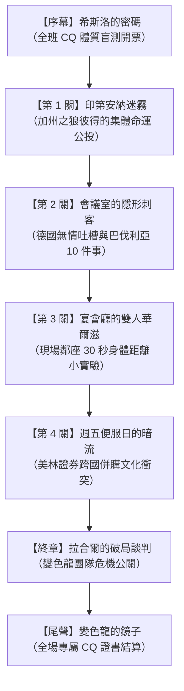

# 《邊境解碼者：變色龍計畫》（Project Chameleon: The Cultural Decoder）
## 跨文化智商（CQ）沉浸式互動敘事遊戲 ＆ 現場演講互動 PWA 企劃書

> **理論基礎**：P. Christopher Earley & Elaine Mosakowski (2004), *"Cultural Intelligence"*, *Harvard Business Review*.  
> **核心升級**：**支援「個人沉浸體驗」與「現場演講大螢幕／全員即時互動（Live Presentation Mode）」雙軌運作**。

---

## 1. 專案總覽 (Executive Summary)

### 1.1 專案願景
在跨文化領導力、組織行為學（OB）或商管課堂報告中，傳統簡報往往是「講者在台上念投影片，聽眾在台下滑手機」。  
本專案將 **Earley & Mosakowski (2004) 的 CQ 理論** 轉化為**結合「歐漫繪本風視覺小說」與「現場即時群眾共感投票」的雙軌 PWA 遊戲**。

講者在台上投影大螢幕，台下聽眾只需掃描 QR Code，即可用手機化身「跨文化陪審團」，在關鍵劇情中集體投票決定主角的生死走向，將枯燥的學術報告瞬間轉化為全場沸騰的沉浸式互動劇場！

```
   ┌──────────────────────────────────────────────┐
   │        【講台大螢幕・講者主控端】             │
   │  繪本故事演繹 + 即時全班決策開票 + CQ儀表板  │
   └──────────────────────┬───────────────────────┘
                          │ (即時同步 / WebSocket / 免登入)
       ┌──────────────────┴──────────────────┐
       ▼                                     ▼
┌──────────────┐                     ┌──────────────┐
│  聽眾 A 手機 │                     │  聽眾 B 手機 │
│ 點擊即時抉擇 │                     │ 參與肢體體感 │
└──────────────┘                     └──────────────┘
```

### 1.2 雙軌模式定位
1. **模式 A：現場演講互動模式（Live Presentation / Audience Co-Play）**：
   * 專門針對**課堂期末報告、演講、企業工作坊**設計。
   * 講者主控大螢幕推進劇情，在關鍵決策點開放全場投票，直接將台下聽眾的選擇映射到主角的「身、心、腦」數值變化與劇情走向。
2. **模式 B：個人單機沉浸模式（Single Player Story Mode）**：
   * 聽眾在報告結束後，可將 PWA 加入手機主畫面，於課後離線細玩全部 6 個完整個案關卡，並生成專屬的個人 CQ 診斷雷達圖與結算證書。

---

## 2. 現場演講「全員互動」四大引爆點設計 (Audience Interaction Highlights)

### 引爆點 1：開場 2 分鐘【全班 CQ 體質盲測與基因圖譜】
* **大螢幕呈現**：大螢幕顯示「希斯洛機場的一隻蚱蜢」與一個醒目的即時 QR Code。
* **觀眾手機互動**：
  * 觀眾掃碼免註冊，立刻跳出 3 道直覺快問快答（例如：「當你的好提案被外籍主管公開痛罵毫無邏輯，你的第一反應是？」）。
* **現場高潮**：
  * 30 秒內，大螢幕動態跑出**「現場全員 CQ 原型分佈圖」**（例如：本班 45% 是鄉土型、30% 是直覺型、僅有 2% 變色龍！）。
  * 講者順勢破冰切入：「看來今天我們全班如果集體被外派，將有近半數的人在第一週就陣亡……」

### 引爆點 2：劇情死活抉擇【全班陪審團・把主角玩殘或封神】
在每個個案的命運轉折點，大螢幕鎖定，進入**「全班命運抉擇時刻（Crowd Choice）」**：
* **案例一（加州之狼彼得的會議衝突）**：
  * 面對印第安納員工的集體冷漠與低頭迴避，大螢幕跳出選項：
    * **選項 A【加州狼性到底】**：拍桌大吼「不滿意就直接說，我們看數字說話！」
    * **選項 B【直接認慫】**：不說話，摸摸鼻子宣布散會。
    * **選項 C【延遲評判 + 策略微調】**：壓低聲量、身體後靠，改為課後一對一私下喝咖啡探詢。
  * **觀眾手機**：全員在 15 秒內進行投票。
  * **即時戲劇反饋**：
    * 若全班多數選了 A $\rightarrow$ 大螢幕彼得的【Heart 心靈值】狂噴暴跌、員工集體離席，觸發「加州之狼徹底破防」的搞笑崩潰漫畫插畫！
    * 講者趁機講解：「大家剛才的集體選擇，完全重現了論文中彼得犯下的『身心腦斷裂』錯誤……」

### 引爆點 3：現場 30 秒【鄰座實體社交距離大實驗】
* **對應章節**：第三章【宴會廳的雙人華爾滋】（Melanie 貼面禮與 Hispanic 社交距離）。
* **現場實體活動**：
  * 講者不只講理論，而是指示：「請全場所有人起立，與你身邊的同學對視，並嘗試往前走一步到 30 公分距離交談 10 秒鐘。」
  * 觀眾在手機螢幕上滑動評分自己的「尷尬/不適指數（Cringe Meter）」。
  * **大螢幕實時生成全場「尷尬熱力圖」**，直觀印證「身體（Physical CQ）的內在防衛機制有多麼強烈」。

### 引爆點 4：終局對決【拉合爾的變色龍危機公關】
* **對應章節**：終章【拉合爾的破局談判】（Nigel 拯救巴基斯坦新創關廠案）。
* **互動機制**：
  * 全班分為三大陣營（手機自動分組）：**「西方創投方」**、**「拉合爾家族方」**、**「變色龍斡旋組」**。
  * 斡旋組必須在手機上挑選正確的文化話術牌（如：引用伊斯蘭共同體責任、借力長老威信），讓大螢幕上的「家族怒氣值」與「創投虧損容忍度」同時降入安全區，達成和平停業。

---

## 3. 系統數值與玩法架構 (Game Mechanics & System)

```
        [ Head 認知洞察值 ]
          /            \
         /   動態平衡   \
        /                \
[ Heart 動機韌性值 ] ── [ Body 鏡像協調值 ]
```

### 3.1 三大心理數值（大螢幕與手機同步連動）
* **Head (頭腦 - 認知洞察)**：掃描環境線索、辨識「針對事情 vs. 針對個人」、克服刻板印象。
* **Body (身體 - 鏡像協調)**：透過滑動距離條、控制語速與姿態，達成言行鏡像（Mirroring）。
* **Heart (心靈 - 動機血量)**：玩家與主角的「心理韌性／自我效能感」。受到誤解扣血，達成小成就（Small Wins）回血，歸零則觸發文化休克（Game Over）。

### 3.2 講者必備：雙重模式安全防護機制（Zero-Risk Failover）
考量到課堂報告現場可能遇到的**「網路延遲、學校 Wi-Fi 斷線」**，系統具備極高可靠性設計：
1. **雲端即時連線模式（Live Sync）**：網路順暢時，全班手機透過 WebSocket / Serverless 即時串流，大螢幕毫秒級開票。
2. **無網演講備援模式（Offline Presenter Override）**：
   * 若教室完全沒有 Wi-Fi，講者可切換為**「現場舉手點選模式」**。
   * 講者在大螢幕上直接點選「全班舉手表決結果」，所有動畫、音效、數值增減與分支劇情照常運行，**保證演講絕對不冷場、不卡關！**

---

## 4. 繪本章節架構（改編自 Earley 2004 經典個案）



---

## 5. PWA 技術架構與現場互動實現方案 (Technical Specs)

### 5.1 前端極簡全響應架構
* **核心技術**：Vue 3 / React + Tailwind CSS + Vite（超極速打包，3 秒內載入完畢）。
* **即時互動通訊**：
  * 使用輕量級 Pub/Sub 服務（如 Supabase Realtime / Firebase / PartyKit），無須自建複雜後端。
  * 觀眾掃碼 URL 攜帶 Session ID（如 `game.app/?room=OB101`），點開即入房，**無需註冊、無需輸入帳號密碼**。
* **PWA 原生沉浸特性**：
  * `display: standalone` 隱藏手機瀏覽器網址列，全螢幕繪本手感。
  * `navigator.vibrate`：當全班投票選出錯誤選項、主角遭受文化打擊時，全班手機同步發出短促震動！

---

## 6. 演講流程腳本規劃（以 15～20 分鐘課堂報告為例）

| 時間區段 | 演講環節 | 講者動作（大螢幕） | 聽眾互動（手機端） |
| :--- | :--- | :--- | :--- |
| **00:00 - 02:00** | **破冰引入** | 投影封面與 QR Code，拋出「高 EQ 經理人為何外派翻船？」 | 掃碼入房，完成「3 題 CQ 盲測」。 |
| **02:00 - 04:00** | **大數據揭曉** | 大螢幕動態開票：展示全班 CQ 體質分佈圖，引導出 Head/Body/Heart 理論架構。 | 看見自己在全班分佈中的位置。 |
| **04:00 - 08:00** | **案例實戰 1（彼得之死）** | 播放加州狼性主管在印第安納受挫的漫畫劇情，發起【全班命運抉擇】。 | 點擊選項投票，看自己的選擇如何重創或拯救彼得的數值。 |
| **08:00 - 11:00** | **實體互動（身體距離）** | 講解 Physical CQ，播放貼面禮與 30 分鐘華爾滋個案。 | 進行現場鄰座對視 10 秒挑戰，手機回傳「尷尬指數」。 |
| **11:00 - 15:00** | **高潮談判（拉合爾破局）** | 講述變色龍 Nigel 案例，引導分組陣營解開巴基斯坦創投死局。 | 挑選文化牌，協助講者在大螢幕上平衡家族與創投訴求。 |
| **15:00 - 18:00** | **結語與證書** | 總結 Earley (2004) 金句，大螢幕打出通關金句。 | 手機端生成個人專屬 CQ 繪本風格診斷成就卡，長按可儲存分享。 |

---

## 7. 預期成效 (Expected Impact)

1. **徹底打破傳統報告沉悶感**：把台下「被動聽眾」直接轉化為「故事決策者」，全場注意力百分之百鎖定講台。
2. **學術理論與情緒體驗深度綁定**：聽眾不再只是死記「身心腦」，而是親身體會「按錯選項被全場扣血」的痛感與笑點。
3. **極高評分潛力**：兼具**理論扎實度（HBR 2004 經典名篇）**、**前沿技術力（PWA 即時同步雙軌）**與**高超的演講控場設計**。
